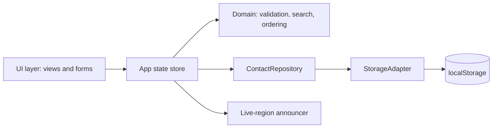
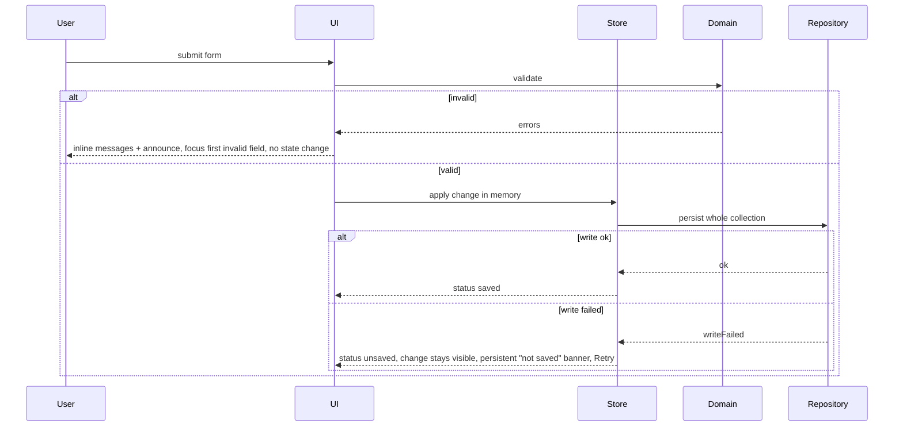
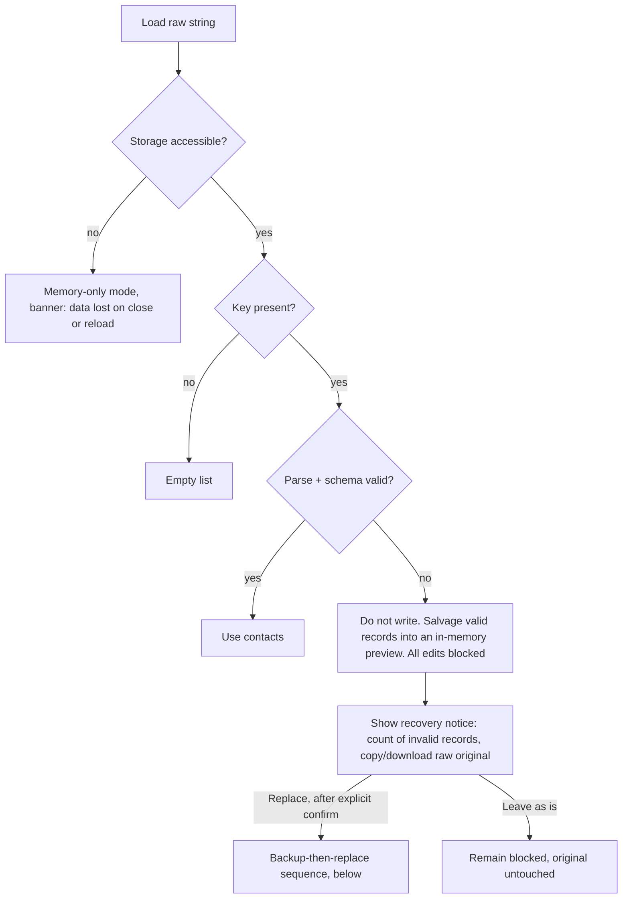

# Architecture - Contact Management System

**Status: APPROVED by the user on 2026-10-22, with Q-08 and Q-15 still open.** Approval was given by the user ("i approve go ahead") in the main Claude Code session after being shown a summary of this revision, and was recorded here by the main session on their behalf, not by the SDLC orchestrator. Scope: this file as revised, including the two readings the user was asked to confirm and approved together with the document: (1) backup key deletion happens after the new write succeeds and the user confirms the result (Q-23); (2) if the backup write fails, replacement is allowed only after the user confirms they have copied or downloaded the raw original. Also covered: the agent proposals for the hidden-by-search announcement and the multi-tab stale-save check (section 6a). Not covered: Q-08, Q-15, and the hosting choice stay open. `design-review.md` revision 3 has since re-validated against this revision (per its own status line); that re-validation is a fact about scope/content, not an approval, and design-review.md remains PROVISIONAL and not gate-clearing for the separate, unverified-approval-chain reason stated in its own status line.

**Basis for drafting (historical, superseded by the status above):** `requirements.md` carried "PROPOSED (not approved)" at drafting time and no `.github/sdlc-status.md` exists. The coordinator relayed that the user replied "i approve" and that it was interpreted as authorising a draft-only architecture. That interpretation is the coordinator's, not recorded approval. This draft therefore treats requirements as the working input and Q-01 to Q-16 (requirements section 9) as unresolved assumptions and risks. Approval of requirements, and then of this document, must be recorded by the Orchestrator and the user.

**Revision note (user answers incorporated):** The coordinator relayed that the user replied "accept" in the main session to a table of default decisions. That relayed reply is the source for the decisions marked **[DECIDED by user answer]** below (Q-01..Q-07, Q-09..Q-14, Q-16..Q-23). It is an answer to open questions, not approval of this document or of `requirements.md`. **Q-08 and Q-15 remain OPEN** (provisional defaults kept). `design-review.md` was written against the earlier draft of this document; its findings DR-01, DR-04, DR-06 and DR-08 are addressed here where decisions allow (see section 17). The review (now revision 3) has since re-validated against this revision; that re-validation is not an approval of either document.

**Sources:** `requirements.md` (FR-01..FR-57, NFR-01..NFR-11), `.claude/input/userstory.md`.

Legend: **[SUPPORTED]** follows directly from a requirement. **[DECIDED by user answer]** settled by the relayed "accept" reply (not a requirement change; requirements text still needs its own approval). **[PROPOSED]** an architect's choice. **[ASSUMPTION]** not confirmed.

## 1. System overview and approach
A client-only single-page web application. No server, no accounts, no network calls at runtime. All state lives in the browser; contacts are persisted in `localStorage`.

- [SUPPORTED] Browser app, local storage persistence (FR-40, FR-41, F1). No backend is required by any requirement (section 2 of requirements).
- [SUPPORTED] Single local user, no authentication (A1; confirmation pending Q-12).
- [PROPOSED] Static assets only, so deployment is hosting of files (section 10).



## 2. Components and responsibilities
| Component | Responsibility | Requirements |
|---|---|---|
| UI layer | Contact list, empty state, add form, edit form, delete confirmation, search box, no-match message, status/not-saved banner. Semantic HTML, responsive CSS. | FR-01, FR-07, FR-09..FR-12, FR-14..FR-17, FR-20, FR-22..FR-25, FR-27, FR-28, FR-33, FR-34, NFR-01..NFR-06 |
| App state store | Holds in-memory contacts, search query, edit target, save status (`saved` / `unsaved` / `recovery-needed`). Single source of truth for rendering. Applies change in memory first, then asks repository to persist. | FR-45, FR-46 |
| Domain module (pure functions, no I/O) | `validateName`, `validatePhone`, `normalizePhone`, `matchContact(query)`, ordering. | FR-02..FR-06, FR-18, FR-19, FR-28..FR-31, FR-11 |
| ContactRepository | Load, validate stored data, save whole collection, expose typed results (`ok`, `unreadable`, `writeFailed`). Never throws to the UI. | FR-40..FR-46 |
| StorageAdapter | Thin wrapper over `localStorage` (get/set/remove) so failures can be injected in tests. Catches `SecurityError`, `QuotaExceededError`, unavailable storage. | FR-45, FR-46, testability |
| Announcer | Visually hidden `aria-live` regions (polite for updates, assertive for errors); focus management after add, edit, delete, cancel. | NFR-03..NFR-05 |

## 3. Technology choices
| Decision | Proposal | Justification | Status |
|---|---|---|---|
| Language | TypeScript (strict), bundled by the build | Typed data model and Result types reduce storage-handling defects. | [DECIDED by user answer] Q-17 |
| UI approach | Plain DOM / small templating, no framework | Scope is small (one screen, 8 stories); simplest option meeting requirements. A framework is not required by any FR/NFR. | [DECIDED by user answer] Q-17 |
| Build | Single bundler (for example Vite) with npm, producing static files; pin versions and commit a lockfile at planning time | Dev server, TS compile and test runner integration. | [DECIDED by user answer] Q-18 (tool choice Vite is [PROPOSED]) |
| Styling | Hand-written CSS, mobile-first, relative units, CSS custom properties | NFR-01 (320 px), NFR-06 (contrast, target size). | [PROPOSED] |
| Persistence | `localStorage`, one versioned key (for example `contacts.v1`) holding JSON `{version, contacts[]}` | Mandated by FR-40. Versioning supports future migration and the validation in FR-42. | [SUPPORTED] storage; [PROPOSED] key and envelope |
| IDs | `crypto.randomUUID()` with fallback generator | Unique internal id, phone never used as key (FR-36, FR-39). | [PROPOSED] |
| Unit tests | Vitest (or equivalent) | Pure domain and repository testable without a browser. | [PROPOSED] |
| E2E / a11y tests | Playwright with axe-core | Automated a11y checks, keyboard flows, storage failure injection at 320 px and desktop. | [PROPOSED] Q-08, Q-15 |

## 4. Data model
```
Contact {
  id: string          // UUID, immutable, never derived from phone (FR-36, FR-39)
  name: string        // trimmed, 1..100 characters (Q-01, Q-03)
  phone: string       // as entered after trimming, at most 20 characters; normalized digits derived, not stored
  createdSeq: number  // monotonic creation counter, immutable (FR-08, FR-11, FR-21)
  createdAt: string   // ISO timestamp, informational
}
StoredEnvelope { version: 1, nextSeq: number, contacts: Contact[] }
```
- [PROPOSED] Order key is `createdSeq` (descending for display). It resolves same-millisecond ties and means edits never move a contact (FR-21). Meaning of "newest" accepted per Q-04 [DECIDED by user answer]. Using `createdSeq` also means deleting then adding never reuses a position because `nextSeq` only increases.
- [PROPOSED] Phone is stored as entered (formatting kept) so the edit form shows what the user typed (FR-16); digits are derived at validation and search time.
- [ASSUMPTION] Only `name` and `phone` are user fields (A2, Q-13). Internal fields (`id`, `createdSeq`, `createdAt`) are not user-visible.

## 5. Key rules (domain)
- **Phone validation** [SUPPORTED FR-03..FR-05]: trim; reject if any letter present (covers `ext`, `x`); allow only digits, leading `+`, spaces, hyphens, parentheses; strip formatting; require 7-15 digits. `+` is not counted. A `+` not at the start is rejected [DECIDED, impl-plan.md decision 3 (T-02): "a `+` is rejected anywhere except the start of a phone"]. Unbalanced parentheses are not checked [ASSUMPTION, Q-01].
- **Name validation** [DECIDED by user answer Q-01, Q-03]: trimmed value must be non-empty; no character restrictions; trimmed before save; maximum 100 characters after trimming. Over-length input is rejected with an inline message (not silently truncated).
- **Phone length limit** [DECIDED by user answer Q-03]: the trimmed entered string may be at most 20 characters, in addition to the 7-15 digit rule. Stored-data validation applies the same limits.
- **Length counting for the 100/20 limits** [DECIDED, impl-plan.md decision 1 (T-02, T-03)]: "the 100/20 length limits are counted in code points"; both the name's 100-character limit and the phone's 20-character limit are measured in Unicode code points (`Array.from`), not UTF-16 code units.
- CSS uses `overflow-wrap: anywhere` regardless, for NFR-01 (addresses DR-07).
- **Edit uses the same validators as add** [DECIDED by user answer Q-02; FR-18].
- **Search** [SUPPORTED FR-28..FR-34, details ASSUMED Q-09]: one input; case-insensitive substring match on name using locale-aware lowercasing; phone match is substring on digits after stripping spaces, hyphens, parentheses and `+` from both query and stored value; a query with no digits does not match on phone [DECIDED, impl-plan.md decision 2 (T-05): "a phone search query with no digits matches no phones", e.g. a query of `-`]; empty query shows all. Search state is in memory only and not persisted across refresh. Edit and delete are available from filtered results (Q-10, [DECIDED by user answer] default). The active search is **not** cleared when a contact is added [DECIDED by user answer Q-10; the earlier clear-on-add behaviour is removed]. If a newly added contact does not match the active query, [PROPOSED] the app shows a visible status message near the list ("Contact saved, but it is hidden by the current search") and the polite live region announces the same text, so sighted and screen-reader users are both informed (DR-17); the query itself is never changed by the app (addresses DR-06).
- **Duplicates** [SUPPORTED FR-35..FR-39]: no uniqueness check on phone; all operations address contacts by `id`. No duplicate warning (Q-11); fully identical name+phone records permitted (Q-11).

## 6. Workflows
### Add / edit / delete (save path)

- [SUPPORTED FR-45, FR-46] Success is only shown after the adapter write returned without exception. For all saves (add, edit, delete), the unsaved banner persists until a later save succeeds, and a Retry action is offered [DECIDED by user answer Q-07]. A successful later save persists the whole current in-memory collection, including earlier unsaved changes; the banner says so (DR-14). After a reload, unsaved changes are lost, and the banner text states this.
- [PROPOSED] Pre-write staleness check: before each write the repository re-reads the stored raw string and compares it with the raw string last loaded or written by this tab. A mismatch means another tab changed the data (see multi-tab handling, section 6a) and the write is refused until the user reloads.
- [PROPOSED] Delete uses an accessible modal dialog (native `<dialog>` or ARIA dialog with focus trap and return of focus), default focus on Cancel (FR-23, FR-25, NFR-02, NFR-04).
- [PROPOSED] Edit is inline in the list item or a form panel; Cancel (and Esc) discards and restores focus to the edit trigger (FR-20).

### Startup and storage recovery

- [SUPPORTED FR-42..FR-44] Stored data is parsed in a try/catch and checked against the schema before use. Record-level rules: string `id` (unique), `name` (trimmed, 1..100), `phone` (passes phone rules, at most 20 characters), `createdSeq` a non-negative integer, unique across records. Envelope-level rules: `version` is 1, `contacts` is an array, `nextSeq` is an integer. No write to the contacts key happens while in recovery state.
- [DECIDED by user answer Q-05, Q-06] "Recovery" = salvage valid records into an in-memory preview, keep a raw backup of the original, and offer copy/download of the raw original. Valid records are kept; invalid ones are reported by count. Because counting hides the content of invalid records, the raw copy/download is the way to see them (DR-04 note).
- [DECIDED by user answer Q-22] All add, edit and delete actions are blocked during recovery until the user decides (replace or leave as is). The UI shows the salvaged preview read-only and search may be allowed (read-only, [PROPOSED]).
- [PROPOSED, DR-16; recommended option chosen via relayed user reply] Colliding records: if two or more stored records share an `id` or a `createdSeq`, the first in stored array order is kept (if otherwise valid) and every later colliding record is counted as invalid and reported by count (FR-52). The rule is deterministic and applies to the salvaged preview; the raw original is untouched.
- [PROPOSED, addresses DR-04] Sequence consistency: `createdSeq` must be unique among records; a duplicate `createdSeq` is a validation failure and sends the data to recovery (nothing is silently renumbered; salvage applies the collision rule above). `nextSeq` must be an integer greater than the maximum `createdSeq`; if only `nextSeq` is stale or missing while all records are valid, it is recomputed in memory as `max(createdSeq)+1` (or 0 when empty) and written on the next successful save, with no recovery prompt.

### Backup-then-replace ordering (addresses DR-01)
Storage may be full or failing, so the backup write itself can fail. [DECIDED by user answer Q-23] There is no lasting backup key: the backup exists only to protect the replacement and is deleted after the user confirms the replacement. Ordering [PROPOSED]:
1. User chooses Replace and confirms. The original value of the contacts key is not touched yet.
2. The app offers copy/download of the raw original (the user-controlled copy, independent of storage).
3. Write the raw original to a temporary backup key (for example `contacts.v1.backup`). If this write fails (quota, blocked), abort the replacement: the contacts key stays untouched, the user is told why, and may retry. Replacement proceeds without a storage backup only if the user explicitly confirms that they have copied or downloaded the raw original [ASSUMPTION; wording to be checked].
4. Write the new envelope (salvaged records or empty) to the contacts key. A failed `setItem` leaves the previous value in place, so on failure the original is still intact; abort and keep the backup.
5. After the new write succeeds, show the result and ask the user to confirm it. On confirmation, remove the backup key. Until confirmed, the backup is kept (overwritten only by a later recovery). If a leftover backup key is found at startup, the app offers to restore from it or discard it; the leftover is never silently deleted or silently used.
6. Removal failure of the backup key is non-fatal and reported; the user can retry discarding.

[DECIDED, impl-plan.md decision 4 (T-10), settling DR-01]: "a leftover backup key found at startup is handled first (offer restore or discard); any new corruption is handled afterwards." That is, at startup the leftover-backup check (step 5 above) runs and is resolved by the user before any newly found corruption of the contacts key is presented to them.

### 6a. Multi-tab handling (Q-20)
[DECIDED by user answer Q-20; promoted from optional to included.] The app listens to the `storage` event on the contacts key (and checks on window focus). When another tab changes the data, this tab shows a warning banner with a Reload action. [PROPOSED] Until the user reloads, saves from this tab are refused by the pre-write staleness check (section 6) so a stale tab cannot overwrite newer data; the pending in-tab change stays visible. Unsaved form input is not discarded without the user's action. This addresses DR-02 for the cases it can detect; there is no cross-tab locking.

- [PROPOSED, DR-15; user chose the recommended option via relayed reply] If the user presses Reload on a stale tab while a pending unsaved edit or form input exists, the app asks first with two choices: "Keep editing" (stay, nothing discarded, saves remain refused) or "Reload and discard" (load the newer data, drop the pending edit). Nothing is discarded without that explicit choice. No merge or re-apply is offered.
- **ACCEPTED residual risk (DR-02; accepted by the user via relayed reply):** two tabs writing within the same instant, before either sees the `storage` event or the staleness check can detect it, can lose one write. For a single-user app (A1) this is accepted; no locking is added. This acceptance covers only this risk.

### 6b. Storage unavailable at load
[DECIDED by user answer Q-21] Memory-only mode is acceptable. A persistent banner states that contacts will be lost when the tab is closed or reloaded; Retry re-tests storage.
- [DECIDED, impl-plan.md decision 5 (T-09), settling DR-02]: "if storage was unavailable at load, the staleness baseline is absent, and the user is warned before the first successful write." That is, the pre-write staleness check (section 6) has no prior raw string to compare against in this case; the first write that finds a value already present is refused as stale, and the user is warned about this before that first successful write.

## 7. Interfaces
No external APIs. Internal contracts (TypeScript signatures, illustrative only):
- `ContactRepository.load(): LoadResult` where `LoadResult = {kind:'ok', contacts, nextSeq} | {kind:'empty'} | {kind:'unreadable', raw, salvaged, reason} | {kind:'unavailable'}`.
- `ContactRepository.save(state): {kind:'ok'} | {kind:'writeFailed', cause}`.
- `Domain.validate(input): {ok:true, value} | {ok:false, errors:{name?:string, phone?:string}}`.
- `Domain.filter(contacts, query): Contact[]`.

## 8. Security, privacy and secrets
- Contact data is personal data in plaintext `localStorage`, readable by anyone with access to the browser profile and by any script on the same origin (requirements section 8; Q-12). No encryption is proposed because none is required and a client-side key would add little protection.
- [PROPOSED] Render all user data with `textContent` / escaped templates, never `innerHTML`, to prevent XSS from stored names. Add a restrictive Content-Security-Policy (no inline scripts, `default-src 'self'`) in hosting config.
- [PROPOSED] No secrets, no analytics, no third-party scripts or CDN fonts at runtime, so no data leaves the device.
- [PROPOSED] Imported-from-storage data is untrusted and validated (FR-42).
- Not proposed (not required, Q-12): clear-all-data function, privacy notice.

## 9. Error handling
| Condition | Behaviour | Requirement |
|---|---|---|
| Invalid input | Inline message tied to field (`aria-describedby`, `aria-invalid`), summary announced, nothing saved | FR-06, FR-19, NFR-03, NFR-05 |
| Storage write fails (quota, disabled, private mode) | Change remains in memory; persistent "not saved" banner; no success message | FR-45, FR-46 |
| Storage unavailable at load | Memory-only mode with banner (Q-21 decided) | FR-45 (extended; Q-07, Q-21) |
| Unreadable stored data | Recovery flow, edits blocked, no overwrite without confirmation, backup-then-replace ordering | FR-43, FR-44 |
| Another tab changed data | Warning banner, Reload, stale saves refused | FR-40, FR-46 (Q-20) |
| Unexpected exception | Caught at repository and event boundaries; generic error banner; no data loss in memory | general |

## 10. Test strategy and testability
- **Unit (Vitest):** phone validator boundaries 6/7/15/16 digits, `+1 (555) 123-4567`, `+1234567`, letters, `ext`, `x12` (FR-03..FR-05); name rules; search (case, formatting, partial, no-digit query); ordering with ties; duplicate phones addressed by id.
- **Repository tests with fake StorageAdapter:** malformed JSON, wrong shape, mixed valid/invalid records, duplicate ids, duplicate `createdSeq`, stale `nextSeq` (recomputed), name 100/101 characters, phone 20/21 characters, write throws `QuotaExceededError`, storage access throws `SecurityError`; backup write failing aborts replacement with original intact; backup removed only after confirmation; stale-tab write refused; assert original raw value untouched until confirmed (FR-42..FR-46).
- **E2E (Playwright):** add/edit/delete/search flows, reload persistence, cancel flows, 320 px width with no horizontal overflow (NFR-01), keyboard-only run (NFR-02, NFR-04).
- **Accessibility:** automated axe-core checks in E2E; manual keyboard and screen-reader sessions (tools and OS/browser pairs pending Q-08, Q-15). Per NFR-08 no conformance claim is made until all three are executed and recorded.
- **Added for FR-47..FR-57 and NFR-09..NFR-11 (DR-19):**
  - FR-47: name `"  Ann  "` saved as `Ann`; `"   "` rejected; name `<b>x</b>` accepted.
  - FR-48: name 100/101 and phone input 20/21 characters; rejected with message, nothing saved or truncated (no HTML `maxlength`).
  - FR-49: run every add validation case through edit; outcomes identical.
  - FR-50: rapid adds, edit the oldest, delete the newest then add; order and position checks.
  - FR-51/FR-52: unreadable value gives salvage, raw backup and untouched original until confirmation; 3 valid plus 2 invalid (including duplicate id and duplicate `createdSeq`) shows 3 contacts and a count of 2; first-by-stored-order kept (DR-16).
  - FR-53: forced write failure on add, edit and delete; banner persists until a later save succeeds; Retry offered and clears the banner.
  - FR-54/FR-55: search forms from requirements section 6; edit and delete from results; non-matching add keeps the query, shows the visible and announced hidden-by-search notice (DR-17); reload empties the query.
  - FR-56: two identical name+phone contacts saved, no warning.
  - FR-57 (two-tab E2E): change data in tab A then act in tab B; warning shown, stale save refused, A's change not overwritten; Reload with a pending edit asks "Keep editing" or "Reload and discard" (DR-15).
  - NFR-09: name `` displayed literally, no script runs, no login.
  - NFR-10/NFR-11: UI review for English; load a few hundred contacts and confirm list, add and search remain usable.
- Requirement-to-test mapping follows requirements section 6.

## 11. Proposed repository structure
```
/
  requirements.md
  architecture.md
  index.html
  package.json
  src/
    main.ts
    domain/      phone.ts, name.ts, search.ts, ordering.ts
    storage/     adapter.ts, repository.ts, schema.ts
    state/       store.ts
    ui/          list.ts, form.ts, confirmDialog.ts, banner.ts, announcer.ts
    styles/      main.css
  tests/
    unit/  e2e/  a11y/
```
Structure is indicative; final layout belongs to the implementation plan.

## 12. Deployment and environments
- [DECIDED by user answer Q-19] Build to static files and serve from a static host; no CI for now. No server config beyond optional CSP headers. No environment variables or secrets. One configuration constant: storage key name.
- [PROPOSED, addresses DR-08] Opening the built app from `file://` is **not supported**: browsers commonly block module scripts there, and the plan relies on a bundled build served over HTTP(S) (a local static server is fine for development). The earlier "open from file system" claim is withdrawn. The CSP is delivered by header where the host allows, otherwise by a `<meta http-equiv>` tag (which cannot express every directive, such as `frame-ancestors`). The specific host is still unnamed.
- [ASSUMPTION] `localStorage` is origin-scoped; changing hosting origin or path origin makes existing data invisible (C1). Document this to the user.

## 13. Requirement traceability
| Requirements | Architecture elements |
|---|---|
| FR-01..FR-08 | Domain validators, add flow, `createdSeq` ordering, UI form |
| FR-09..FR-14 | UI list, empty state, responsive CSS, sorting by `createdSeq` |
| FR-15..FR-21 | Edit form, same validators (Q-02), `createdSeq` immutable |
| FR-22..FR-27 | Confirm dialog, id-based removal, empty state |
| FR-28..FR-34 | `Domain.filter`, single search input, no-match message |
| FR-35..FR-39 | UUID `id`, no phone uniqueness, id-addressed operations |
| FR-40..FR-46 | Repository, StorageAdapter, schema validation, recovery flow, save status |
| FR-47, FR-48, FR-49 | Domain name/phone validators shared by add and edit; trim, 100/20 limits, reject not truncate (section 5) |
| FR-50 | `createdSeq` and `nextSeq` ordering (section 4) |
| FR-51, FR-52 | Recovery flow, salvage with collision rule, raw backup, backup-then-replace, count of invalid records (section 6) |
| FR-53 | Save status, persistent banner, Retry (section 6) |
| FR-54, FR-55 | `Domain.filter`, in-memory query not cleared on add, visible and announced hidden-by-search notice (section 5) |
| FR-56 | No phone uniqueness or duplicate warning (section 5) |
| FR-57 | `storage` event, pre-write staleness check, Reload with discard prompt, accepted residual race (section 6a) |
| NFR-01..NFR-06 | Semantic HTML, CSS, Announcer, focus management, dialog |
| NFR-07, NFR-08 | Test strategy section 10 |
| NFR-09 | Escaped rendering via `textContent`, CSP, no auth, no clear-all (section 8) |
| NFR-10 | English UI strings, wording chosen at design (section 9) |
| NFR-11 | Name and phone only; whole-collection rewrite at hundreds of contacts (section 4, R-C) |

## 14. Decisions and risks from Q-01 to Q-16
Status column: **Decided** = settled by the relayed user "accept" reply (defaults in this table, with the changes noted). **OPEN** = unanswered; provisional default kept and not a decision.

| Q | Question (short) | Position in this draft | Status | Risk if wrong |
|---|---|---|---|---|
| Q-01 | Name validity, trimming | Trim; non-empty; no character restrictions | Decided | Rework validators and tests |
| Q-02 | Edit rules = add rules | Same rules | Decided | Edit validation divergence |
| Q-03 | Length limits | Name max 100, phone max 20 characters | Decided | Limits may truncate real data entry |
| Q-04 | Meaning of newest | Monotonic creation sequence, edits never reorder | Decided | Different order expectation |
| Q-05 | Meaning of recovery | Salvage valid records, raw backup, copy/download | Decided | Recovery UI redesign |
| Q-06 | Valid stored data definition | Valid records kept; invalid reported by count | Decided | Invalid records not visible except via raw copy |
| Q-07 | Failed-save scope | All saves; banner persists until a later save succeeds; Retry offered | Decided | Retry/persistence mismatch |
| Q-08 | Browsers, devices, screen readers | Current evergreen browsers; unconfirmed | **OPEN** | Untested combos; a11y claims limited |
| Q-09 | Search matching | Substring; digits-only phone; `+` ignored; one input | Decided | Search mismatch |
| Q-10 | Search and actions | Edit/delete from results; search not persisted; search NOT cleared on add | Decided | UX mismatch |
| Q-11 | Duplicate handling | No warning; identical records allowed | Decided | Unintended duplicates |
| Q-12 | Security/privacy | Single user, no auth; escaped rendering and CSP only | Decided | Privacy expectations unmet |
| Q-13 | Fields and scale | Name and phone only; hundreds of contacts; whole-collection rewrite per save | Decided | Performance and ~5 MB quota at large scale |
| Q-14 | Message wording, language | English, wording chosen by design | Decided | Copy rework, localisation |
| Q-15 | A11y assessment tools and reporter | axe-core + manual keyboard + one screen reader, assessors unnamed | **OPEN** | NFR-07/08 cannot be closed |
| Q-16 | Input location | `.claude/input/userstory.md` is authoritative | Decided | Missed source content |

Additional architecture risks and trade-offs:
- R-A: `localStorage` is synchronous, ~5 MB, and clearable by the user or browser; no backup (C1). Accepted by requirements.
- R-B: Multiple tabs: a second tab can overwrite the first on save. Mitigation included (Q-20 decided): `storage` event warning, Reload, and pre-write staleness check (section 6a). Residual risk: near-simultaneous writes, and `localStorage` has no locking. ACCEPTED by the user via relayed reply for a single-user app (DR-02).
- R-C: Writing whole collection on each change is simple but not atomic with respect to tabs; acceptable at assumed scale.
- R-D: Memory-only mode when storage is blocked means all data is lost on close; communicated via banner (accepted, Q-21).
- R-F: Blocking edits during recovery (Q-22) makes the app read-only until the user decides; the notice must make the choices obvious.
- R-G: Replacement without a successful storage backup relies on the user's own copy/download (section 6, step 3).
- R-E: WCAG 2.2 AA cannot be fully proven by automated tests; manual evidence is required (NFR-08).
- Trade-off: no framework keeps the dependency count low but increases hand-written focus and ARIA code; a framework could be chosen if the team prefers (Q-17).

## 15. Questions raised by this architecture (Q-17..Q-23)
All answered by the relayed user "accept" reply:
- **Q-17 Decided:** TypeScript with no-framework UI is acceptable.
- **Q-18 Decided:** a build step and npm tooling (for example Vite) are allowed.
- **Q-19 Decided:** static host; no CI yet. The specific host is not named.
- **Q-20 Decided:** warn/reload when another tab changes data (included, section 6a).
- **Q-21 Decided:** memory-only mode with a banner is acceptable.
- **Q-22 Decided:** block edits during recovery until the user decides.
- **Q-23 Decided:** no lasting backup key; delete it after the user confirms the replacement (section 6). Interpretation: "confirms" means the user confirms the replaced result after the new write succeeds. Tell the Orchestrator if a different meaning was intended.

## Still open
- **Q-08** (supported browsers, devices, screen readers) and **Q-15** (accessibility assessment tools and who reports). Provisional defaults only; NFR-07/NFR-08 conformance cannot be claimed.
- Hosting provider and the exact security-header capability of the chosen host (affects CSP delivery). Deferred: this is a planning input, not decided here.
- Wording check for step 3 of backup-then-replace (replacement without a storage backup after the user confirms their own copy).

## 16. Relationship to design-review.md
`design-review.md` (provisional) was written against the earlier draft of this document. Where this revision changes the design:
- DR-01: addressed by the backup-then-replace ordering and no-lasting-backup decision (section 6); depends on the Q-23 interpretation. The remaining sub-question it raised (leftover backup key found at startup versus newly found corruption) is now recorded as settled by impl-plan.md decision 4 (T-10) in section 6 above: the leftover backup is handled first, any new corruption afterwards.
- DR-02: mitigated by section 6a (decided Q-20); the residual near-simultaneous-write risk is recorded as accepted by the user (relayed reply), no locking. The remaining sub-question it raised (the staleness-check baseline when storage was unavailable at load) is now recorded as settled by impl-plan.md decision 5 (T-09) in section 6b above: the baseline is absent, and the user is warned before the first successful write.
- DR-15: stale-tab Reload asks the user before discarding a pending edit (section 6a).
- DR-16: collision rule keeps the first by stored order, counts the rest as invalid (section 6).
- DR-17: hidden-by-search notice is visible and announced (section 5).
- DR-19: traceability (section 13) and tests (section 10) extended to FR-47..FR-57 and NFR-09..NFR-11.
- DR-04: addressed by sequence consistency rules in section 6; "invalid reported by count" is a user decision (Q-06) and still hides content except via raw copy.
- DR-05: Q-21 and Q-22 decided by the user.
- DR-06: clear-on-add removed (Q-10).
- DR-07: limits decided (Q-03).
- DR-08: file-open claim withdrawn; meta-CSP fallback (section 12).
- DR-09: Q-17/Q-18 decided; version pinning is still a planning task.
- DR-03, DR-10, DR-11, DR-12 (locale-aware lowercasing still in the search rule; not changed here), DR-13, DR-14 (banner wording noted) are not fully resolved. Q-08 and Q-15 remain open.
The review (design-review.md revision 3) has since re-validated against this revision; no finding is closed by this document, and that re-validation does not make design-review.md approved or gate-clearing (it remains PROVISIONAL for the separate, unverified-approval-chain reason stated in its own status line).

## 17. Approval
Approved by the user on 2026-10-22 ("i approve go ahead"), recorded by the main session, as stated in the status line at the top. The DR-02, DR-15, DR-16, DR-17 and DR-19 changes in this revision apply the recommended options the user approved via a relayed reply. Not approved or accepted: Q-08, Q-15 (still open, not accepted as risk, so no WCAG conformance claim) and the hosting choice (deferred to planning). `design-review.md` revision 3 has since re-validated against this revision; that re-validation is not an approval and does not change its PROVISIONAL, not-gate-clearing status. This file does not record any approval beyond the status line.
